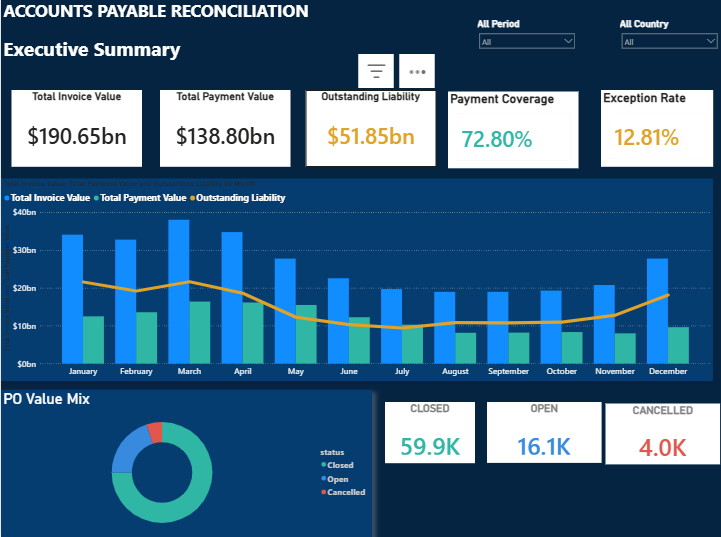
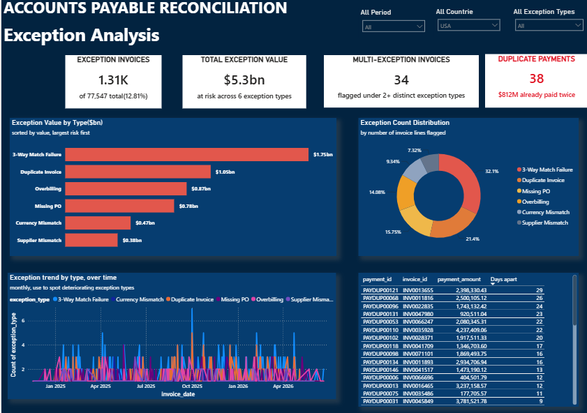
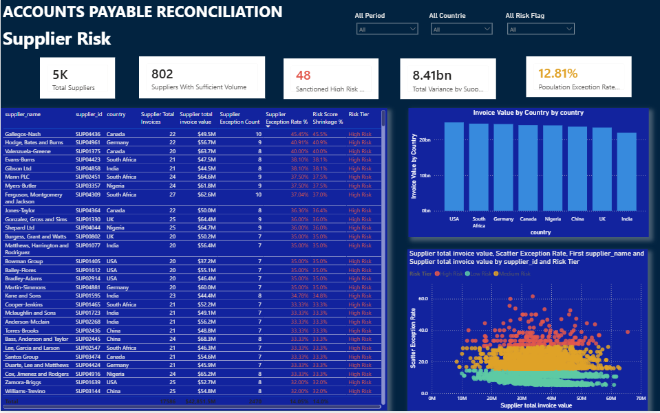
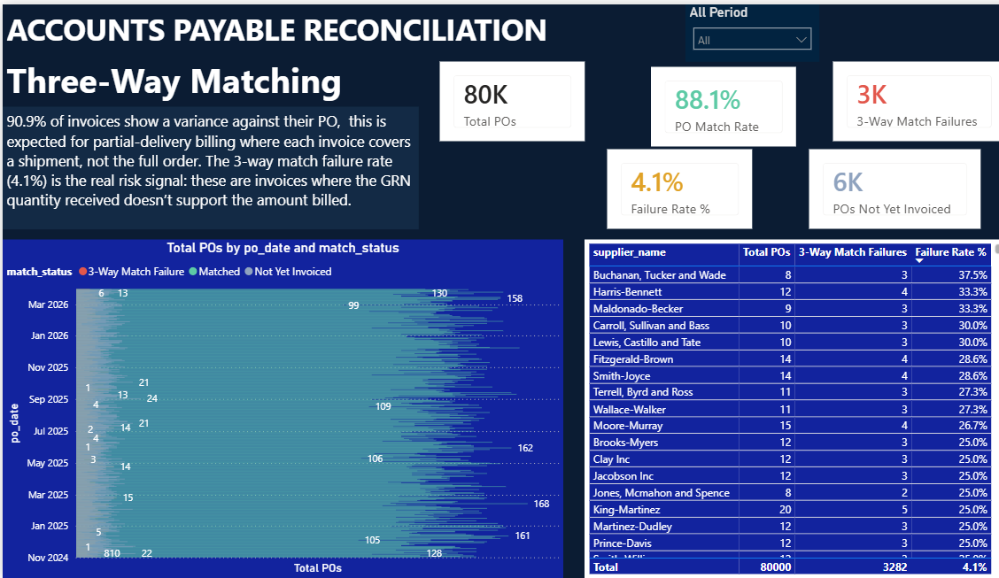
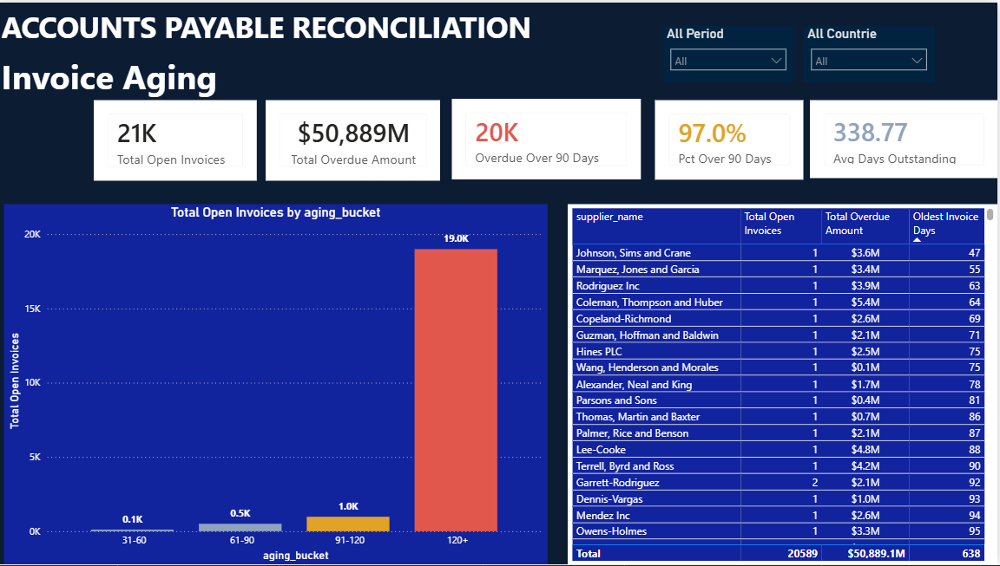
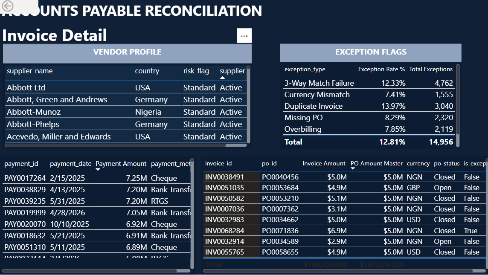
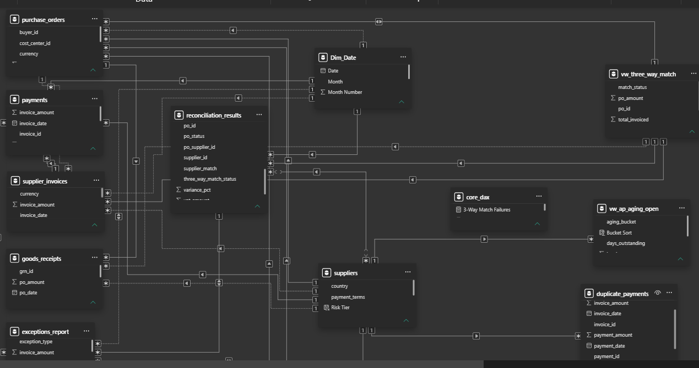

# Account Payable Reconciliation Dashboard

**End-to-end AP intelligence system — Python · PostgreSQL · Power BI · DAX**

[](https://powerbi.microsoft.com)
[](https://www.postgresql.org)
[](https://www.python.org)
[](LICENSE)

---

## The Problem

Accounts Payable teams in large organisations process thousands of invoices monthly — against purchase orders, goods receipts, supplier agreements, and exchange rates. Without a reconciliation layer, errors compound silently: duplicate payments go unnoticed, supplier risk is invisible until it's too late, and ageing invoices turn into write-offs.

This project builds that reconciliation layer from the ground up.

---

## Dashboard Preview

| Executive Summary | Exception Analysis |
|---|---|
|  |  |

| Supplier Risk | Three-Way Match |
|---|---|
|  |  |

| Invoice Ageing | Invoice Detail (Drill-Through) |
|---|---|
|  |  |

---

## What Was Built

A fully automated data pipeline feeds a PostgreSQL analytical database, which powers a six-page Power BI report covering **$193.5 billion in invoiced value** across 802 suppliers.

| # | Page | What it answers |
|---|---|---|
| 1 | **Executive Summary** | What is the total AP exposure? Where does the payment gap sit? |
| 2 | **Exception Analysis** | What went wrong, how much is at risk, and which exception type dominates? |
| 3 | **Supplier Risk** | Which suppliers carry the highest exception rate, adjusted for volume? |
| 4 | **Three-Way Match** | Where do PO, GRN, and invoice fail to align — and by how much? |
| 5 | **Invoice Ageing** | What is the outstanding liability profile across ageing buckets? |
| 6 | **Drill-Through** | What is the full story behind a single invoice — PO, GRN, payments, exceptions? |

---

## Key Findings (from the dataset)

```
Total Invoice Value       $193.5 bn
Total Payments Made       $140.3 bn
Outstanding Liability      $50.9 bn    ← 26.3% of invoiced value unpaid
Payment Coverage            72.5%

Exceptions Flagged          9,933
Value at Risk              $39.7 bn
Exception Rate               5.1%

Suppliers Scored              802
High-Risk Suppliers            48      ← 6% of supplier base, disproportionate risk
Duplicate Payments Found       340     ← recoverable overpayments

Three-Way Match Rate         88.1%
Match Failures              3,282
POs with No GRN Received    6,000+

Open Invoices              21,000+
Oldest Outstanding         180+ days
```

---

## Architecture

```
┌─────────────────────────────────────────────────────────┐
│                     Python Pipeline                      │
│   Synthetic AP dataset → cleaning → PostgreSQL loader   │
└────────────────────────┬────────────────────────────────┘
                         │
                         ▼
┌─────────────────────────────────────────────────────────┐
│                    PostgreSQL Database                   │
│                                                          │
│  Raw tables (facts + dimensions)                         │
│  ├── reconciliation_results  ← central fact              │
│  ├── purchase_orders, payments, goods_receipts           │
│  ├── exceptions_report, duplicate_invoices/payments      │
│  ├── suppliers, exchange_rates                           │
│  └── Dim_Date                                            │
│                                                          │
│  Reporting views (pre-aggregated for Power BI)           │
│  ├── vw_ap_aging_open         → Invoice Ageing           │
│  ├── vw_supplier_risk_ranked  → Supplier Risk            │
│  ├── vw_three_way_match       → Three-Way Match          │
│  ├── vw_duplicate_invoices    → Exception Analysis       │
│  ├── vw_duplicate_payments    → Exception Analysis       │
│  └── vw_po_invoice_match      → Drill-Through            │
└────────────────────────┬────────────────────────────────┘
                         │
                         ▼
┌─────────────────────────────────────────────────────────┐
│                  Power BI Desktop                        │
│                                                          │
│  Data model: star schema                                 │
│  ├── Dim_Date + suppliers as dimensions (1-side)         │
│  ├── reconciliation_results as central fact              │
│  ├── Supporting facts connected by FK                    │
│  └── Reporting views in bottom lane                      │
│                                                          │
│  Measures: core_dax table (all KPIs in DAX)             │
│  Report: 6 pages, cross-filtered, with drill-through     │
└─────────────────────────────────────────────────────────┘
```

---

## Data Model

The Power BI model follows a **star schema** with `reconciliation_results` as the central fact table. Every dashboard page filters through this hub; the reporting views sit in a dedicated bottom lane with no cross-relationships.



**Relationship pattern:**
```
Dim_Date ──────────────────────────────────── 1:M ──► reconciliation_results
suppliers ─────────────────────────────────── 1:M ──► reconciliation_results
purchase_orders ────────────────────────────── 1:M ──► reconciliation_results
reconciliation_results ─────────────────────── 1:M ──► payments
reconciliation_results ─────────────────────── 1:M ──► exceptions_report
reconciliation_results ─────────────────────── 1:1 ──► vw_ap_aging_open
suppliers ──────────────────────────────────── 1:1 ──► vw_supplier_risk_ranked
purchase_orders ────────────────────────────── 1:M ──► goods_receipts
purchase_orders ────────────────────────────── 1:M ──► vw_three_way_match
```

---

## Supplier Risk Scoring

High-risk suppliers are identified using a **shrinkage estimator** — a Bayesian-inspired adjustment that prevents low-volume suppliers from appearing artificially risky based on small sample sizes.

```
Adjusted Exception Rate =
    (exception_count + α) / (total_invoices + β)

    where:  α  =  global mean exception rate × β
            β  =  confidence weight (tuned to dataset)
```

Suppliers below a minimum invoice threshold are flagged `sufficient_volume = False` and excluded from the high-risk ranking. This ensures the risk leaderboard reflects sustained behaviour, not noise.

In this dataset: **Gallegos-Nash** leads with a 39.4% adjusted exception rate across sufficient invoice volume.

---

## Exception Types Tracked

| Exception Type | Description |
|---|---|
| 3-Way Match Failure | Invoice, PO, and GRN do not reconcile |
| Duplicate Invoice | Same vendor invoice number submitted more than once |
| Overbilling | Invoice amount exceeds agreed PO value |
| Missing PO | Invoice raised with no corresponding purchase order |
| Currency Mismatch | Invoice currency differs from PO currency |
| Supplier Mismatch | Invoice supplier does not match PO supplier |

---

## Tech Stack

| Layer | Technology |
|---|---|
| Data generation | Python (Faker, Pandas, NumPy) |
| Data storage | PostgreSQL 15 |
| Analytical views | SQL (6 views, pre-aggregated) |
| Data model | Power BI Desktop — star schema |
| Calculations | DAX — all KPIs computed in `core_dax` measures table |
| Visualisation | Power BI Desktop — 6-page interactive report |

---

## Getting Started

**To explore the dashboard:**

1. Browse the [dashboard screenshots](#dashboard-preview) above for a full page-by-page walkthrough.
2. The `.pbix` file and full pipeline code (`pipeline/`, `sql/`) are being prepared for upload.
3. Connect via [LinkedIn](https://www.linkedin.com/in/yusuf-adetona/) to request early access or discuss the project.

**To reproduce the pipeline** (once code files are published):

**Prerequisites:** Python 3.9+, PostgreSQL 14+, Power BI Desktop (free)

```bash
# 1. Clone the repo
git clone https://github.com/adetonayusuf/Account-Payable-Reconciliation-Dashboard.git
cd Account-Payable-Reconciliation-Dashboard

# 2. Install Python dependencies
pip install -r requirements.txt

# 3. Create the database schema
psql -U postgres -c "CREATE DATABASE ap_reconciliation;"
psql -U postgres -d ap_reconciliation -f sql/01_create_tables.sql
psql -U postgres -d ap_reconciliation -f sql/02_create_views.sql

# 4. Generate and load the dataset
python pipeline/generate_data.py    # creates synthetic AP dataset
python pipeline/load_data.py        # loads into PostgreSQL

# 5. Open Power BI
#    File → Open → AP Reconciliation Dashboard.pbix
#    Home → Transform Data → Data source settings → update connection string
#    Home → Refresh
```

---

## Repository Structure

```
Account-Payable-Reconciliation-Dashboard/
│
├── Executive summary.png           # P1 — Executive Summary dashboard
├── Exception Analysis.png          # P2 — Exception Analysis dashboard
├── Supplier Risk.png               # P3 — Supplier Risk dashboard
├── Three-Way Matching.png          # P4 — Three-Way Match dashboard
├── Invoice Aging.png               # P5 — Invoice Ageing dashboard
├── Invoice Details.png             # P6 — Drill-Through (Invoice Detail)
├── Data Model.png                  # Power BI star schema — model view
└── README.md
```

> **Coming soon:** `pipeline/generate_data.py`, `pipeline/load_data.py`, `sql/01_create_tables.sql`, `sql/02_create_views.sql`, `AP Reconciliation Dashboard.pbix`, and `requirements.txt`. Connect via [LinkedIn](https://www.linkedin.com/in/yusuf-adetona/) to be notified on publish.

---

---

## Design System

The report uses a deliberate dark colour palette:

| Role | Hex | Usage |
|---|---|---|
| Background | `#0B1C33` | Page and card background |
| Primary accent | `#5DCAA5` | Positive KPIs, teal highlights |
| Alert | `#E2574C` | Exception flags, risk indicators |
| Warning | `#E0A227` | Amber metrics, ageing bands |
| Informational | `#378ADD` | Trend lines, filter highlights |
| Muted | `#8FA3BF` | Secondary labels, axis text |

---

## About the Author

**Adetona Yusuf (Yusto)**
Senior Accountant / Business Intelligence Analyst

- CA — Institute of Chartered Accountants of Nigeria (ICAN)
- Microsoft Certified: Power BI Data Analyst Associate (PL-300, 2023 · renewed annually)
- 10+ years across financial reporting, treasury management, and data engineering
- Lagos, Nigeria

[LinkedIn →](https://www.linkedin.com/in/adetona-yusuf) · [GitHub →](https://github.com/adetonayusuf)

---

## Licence

MIT — free to use, adapt, and build on with attribution.
